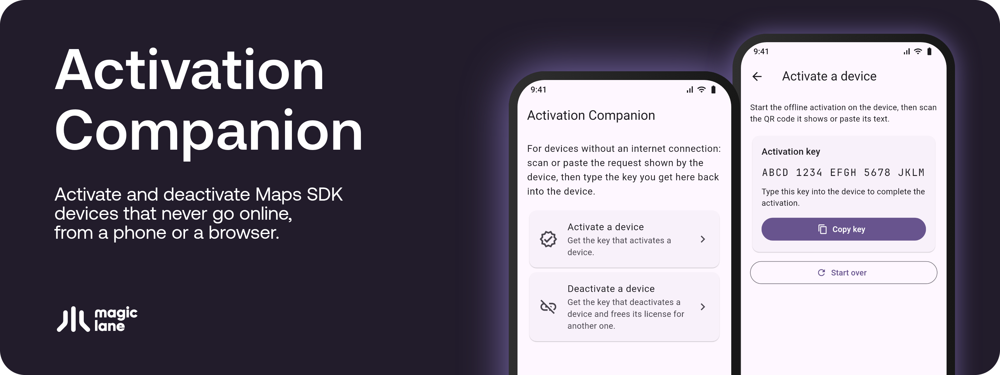
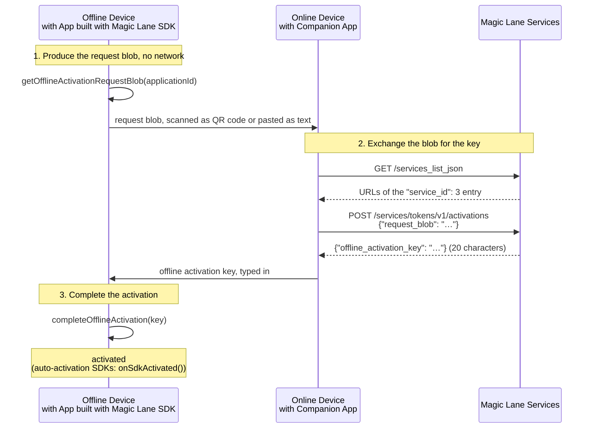
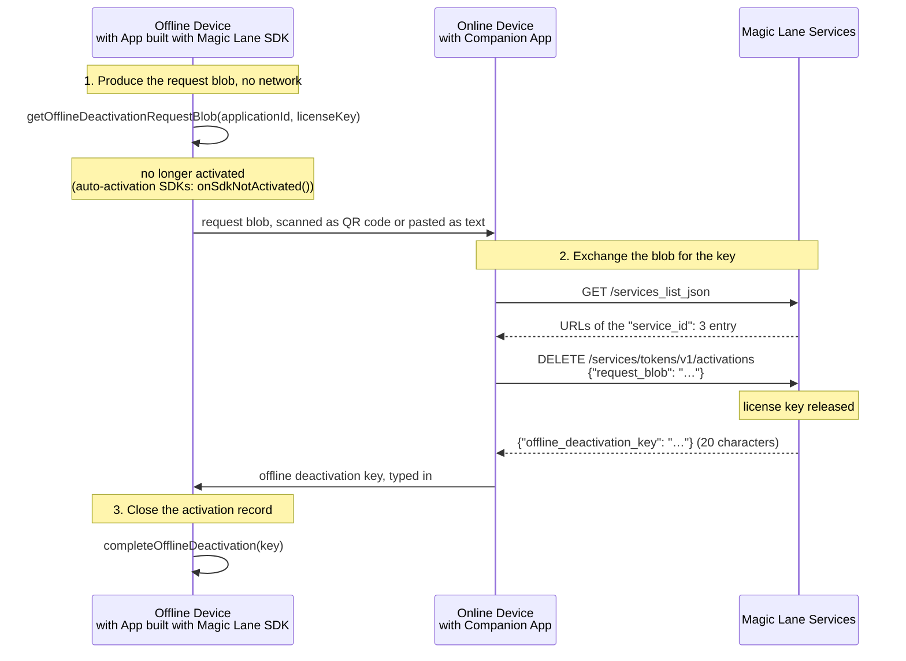

# Magic Lane Activation Companion

Activates and deactivates Magic Lane Maps SDK devices that never go online.

<p align="center">
  
</p>

The device produces a **request blob**. This app takes the blob to Magic Lane Services and shows the 20 character key to type back into the device. It runs on Android, iOS and in the browser.

## When you need it

SDKs downloaded from the [Magic Lane website](https://developer.magiclane.com) activate themselves the first time they reach Magic Lane Services. The offline ceremony is only for devices that never get an internet connection, or that must not connect.

| Situation | What to use |
|---|---|
| The device can go online once | Nothing: auto-activation |
| The device never goes online | **Activate a device** |
| Decommissioning a device, or moving its license key to another device | **Deactivate a device** |

The SDK calls below use the names of the C++ SDK, as in the guide [Activating the SDK](https://developer.magiclane.com/docs/cpp/guides/activation/activating-the-sdk/). The Android SDK uses the same names, except where noted.

## Offline activation



1. **On the device**, produce the request blob. No network is involved.
   - SDKs with auto-activation: `ActivationService().getOfflineActivationRequestBlob(applicationId)`, with the application id from `SdkSettings().getApplicationId()` (`SdkSettings.applicationId` on Android). When no license key is passed, the SDK generates one on the device.
   - SDK builds delivered with license keys: `activate(...)` reports `KRequired` together with the blob.

   Show the blob on the device as a QR code, as text, or both.
2. **In the app**, open *Activate a device*, then scan the QR code or paste the text. The app shows the offline activation key in groups of 4 characters, to read it more easily. Type it on the device as one string of 20 characters, without the spaces. Upper and lower case letters are different. *Copy key* copies it without the spaces.
3. **On the device**, pass the key to `completeOfflineActivation(key)`. The device is activated. SDKs with auto-activation then report `onSdkActivated()`, which always follows an earlier `onSdkNotActivated()`, and their offline functionality becomes available.

An activation lasts as long as the `core-yearly` product of your application: one year, unless Magic Lane set a different duration for it. A device that never goes online cannot renew it, so repeat the ceremony before the activation expires:

- Read the expiry from `getActivationsForProduct()` and plan the renewal from it. `onSdkActivationAboutToExpire()` is reported only at SDK initialization, and only during the last 5 days on SDKs with auto-activation (the last 30 days on SDK builds delivered with license keys).
- SDKs with auto-activation: call `getOfflineActivationRequestBlob(applicationId)` again. The SDK generates a new license key for the new activation.
- SDK builds delivered with license keys: the device needs a new license key. The SDK refuses to activate a license key that is already activated on the device (`KExist`).

## Offline deactivation

Activations are counted per license key, so release a device before decommissioning it or moving its license key.



1. **On the device**, call `getOfflineDeactivationRequestBlob(applicationId, licenseKey)` with the license key of the active activation, read from `getActivationsForProduct()`. On SDK builds delivered with license keys, `deactivate(...)` reports `KRequired` together with the blob.
2. **In the app**, open *Deactivate a device*, then scan or paste the blob.
3. **On the device**, pass the offline deactivation key to `completeOfflineDeactivation(key)`, typed like the activation key: 20 characters, without the spaces, with the same upper and lower case. The activation record on the device becomes `Deactivated`.

> The device stops being activated as soon as it produces the deactivation blob. The license key is released as soon as Magic Lane Services accept the blob in step 2; step 3 only marks the record on the device as `Deactivated`.

## Documentation

The Maps SDK for C++ guides describe every SDK call and REST request used here, including the error responses:

- [Activation](https://developer.magiclane.com/docs/cpp/guides/activation/): overview of the activation modes.
- [Activating the SDK](https://developer.magiclane.com/docs/cpp/guides/activation/activating-the-sdk/): auto-activation, offline activation and deactivation, the activation state notifications.
- [Activation Service](https://developer.magiclane.com/docs/cpp/guides/activation-service/): SDK builds delivered with license keys.

## Build and run

Requires a Flutter SDK that ships Dart 3.13.5 or newer, the constraint in `pubspec.yaml`.

```bash
flutter pub get
flutter run                 # on a connected Android or iOS device
flutter run -d chrome       # in the browser
flutter test
```

Release builds:

```bash
flutter build apk --release --split-per-abi   # one APK per CPU architecture
flutter build ios --release
flutter build web --release
```

In the browser the camera works only over HTTPS or on `localhost`. On a phone, in the app or in the browser, the app opens on *Scan QR code*; on a desktop browser it opens on *Paste text*. On Android and iOS, *Scan from picture* reads the QR code from a picture instead of the camera.

## App architecture

The app keeps the activation service contract, state and UI apart, with the BLoC pattern for state management. It stores nothing on the device:

```
lib/
├── main.dart                            # App entry point: creates the client
├── app.dart                             # MaterialApp, themes and the app-wide client
├── client/                              # REST contract of the activation service
│   └── activation_service_client.dart   # Requests and responses, failures as ActivationServiceException
├── models/                              # Plain data, no Flutter dependencies
│   └── activation_service_exception.dart
├── bloc/                                # State management (BLoC pattern)
│   └── key_request/                     # One key request, sent to the first service URL that may process it
│       ├── key_request_bloc.dart
│       ├── key_request_event.dart
│       └── key_request_state.dart
└── ui/
    ├── monospace.dart                   # The bundled JetBrains Mono font, for keys and request blobs
    ├── pages/
    │   ├── home_page.dart               # The actions
    │   └── offline_key_page.dart        # Activate or deactivate a device
    └── widgets/                         # Reusable UI components
        ├── request_blob_input.dart      # Scan the QR code or paste the text
        ├── qr_scanner_view.dart         # QR code from the camera or a picture
        ├── key_request_view.dart        # Progress, key or error of a request
        ├── issued_key_card.dart         # The key in groups of 4 and a Copy key button
        └── page_body.dart               # Scrollable page content with a readable width
```

The JetBrains Mono font in `assets/fonts` is licensed under the SIL Open Font License 1.1, in `LICENSES/OFL-1.1.txt`.

The tests in `test/` are grouped by the same layers: `client` and `bloc`, with shared fakes in `support`.

## License

Apache License 2.0. See [LICENSE](LICENSE).
